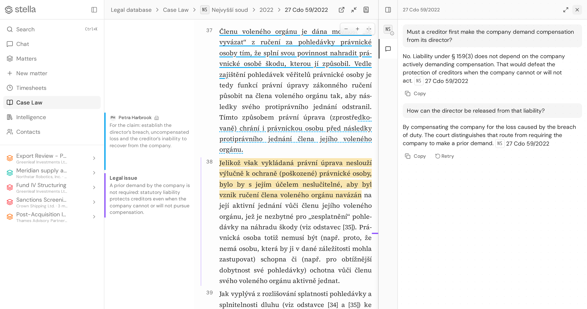
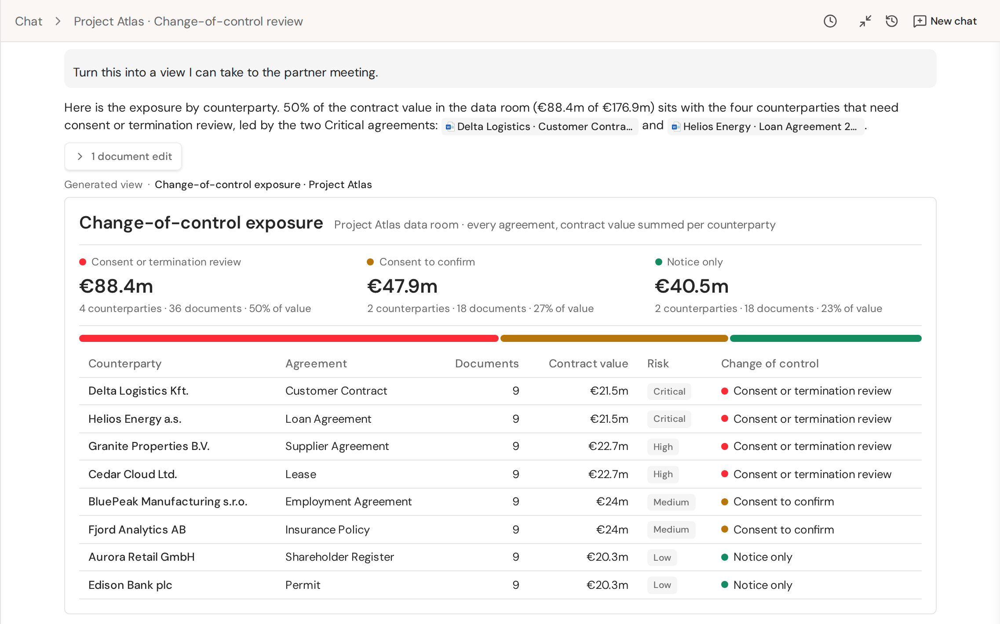
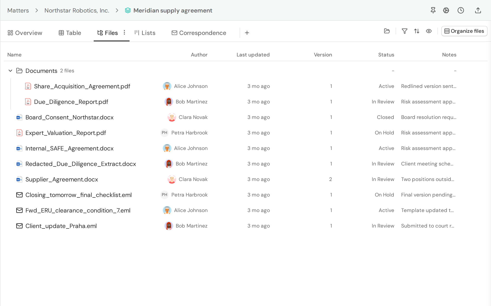
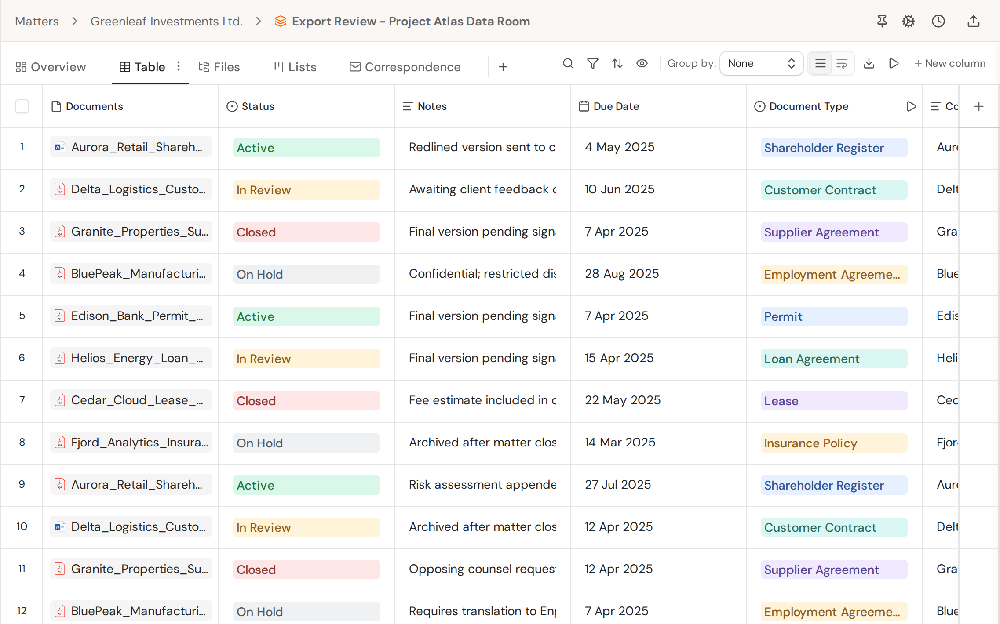
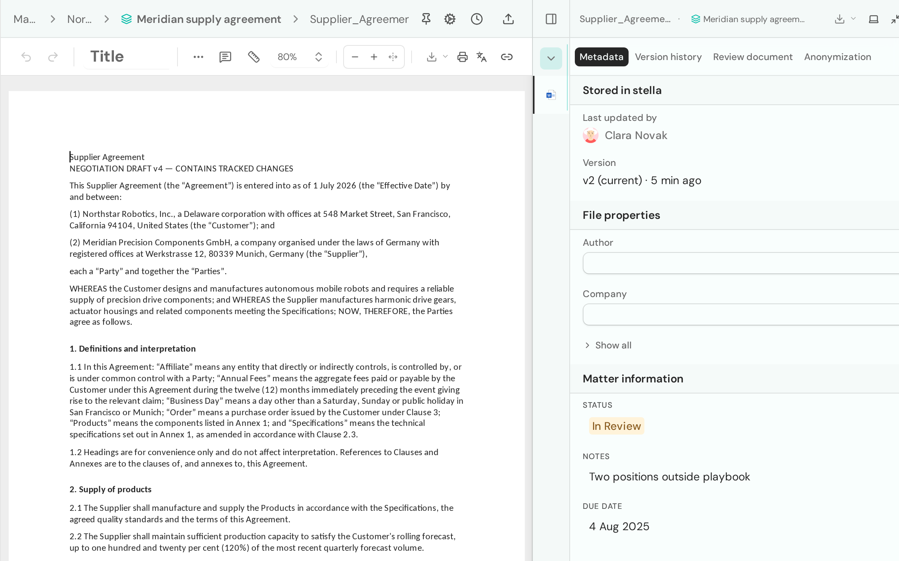
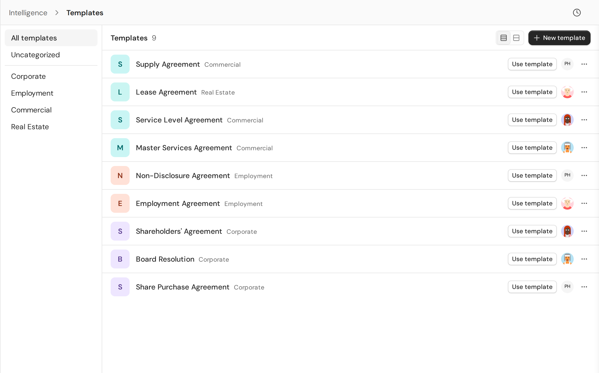

<p align="center">
  
</p>

<p align="center">
  <strong>Legal workspace: free to use, open to inspect, yours to keep.</strong>
</p>

<p align="center">
  <a href="https://stll.app">Website</a> &middot;
  <a href="MANIFESTO.md">Manifesto</a> &middot;
  <a href="https://github.com/stella/stella/issues">Issues</a> &middot;
  <a href="CONTRIBUTING.md">Contributing</a> &middot;
  <a href="https://discord.gg/8dZjmVFjTK">Discord</a>
</p>

<p align="center">
  <a href="https://github.com/stella/stella/releases"></a>
  <a href="https://github.com/stella/stella/blob/main/LICENSE"></a>
  <a href="https://stll.app"></a>
  <a href="https://github.com/stella/stella/issues"></a>
  <a href="https://discord.gg/8dZjmVFjTK"></a>
</p>

<p align="center">
  <picture>
    <source media="(prefers-color-scheme: dark)" srcset="apps/landing/public/media/products/story-public-data-1-dark.png" />
    
  </picture>
  <br /><sub><b>Case law</b> from public sources: read the decision, mark it up, and ask questions answered from its own paragraphs.</sub>
</p>

---

stella is an open-source legal workspace and data stack for legal teams,
currently in beta.

### Data infrastructure

**Case law and public legal sources.** [Legal Atlas](packages/legal-atlas)
holds the corpus runner registry, corpus document kinds, and per-jurisdiction
provision-citation grammars.

**Business registries.** [Business Registries](packages/business-registries)
provides typed clients for national company and commercial registries, including
ARES, Companies House, SEC EDGAR, KRS, PRH, VIES and more.

**Anonymization.** [stella/anonymize](https://github.com/stella/anonymize)
provides WASM-backed anonymization tooling for legal AI workflows, with app
integration through chat and document review.

### Legal intelligence

**Tabular Review.** Extract structured answers from document sets into
matter-scoped review tables for due diligence, discovery and research.

**AI agent.** Chat with matters, files, registries and connected tools, with
approvals and source previews.

**Skills and external connectors.** Reusable prompts, tool definitions and
MCP-compatible tools that extend the agent.

### Workspace

**Web app.** Matters, documents, Word .docx editing, review, research, chat and
knowledge tools in one workspace.

**Desktop app.** Opens Office documents from stella in your local apps and saves edits back, and keeps a clipboard history that stays on your device.

**[stella MCP server](apps/api/src/mcp/README.md).** A central gateway to
access and control stella data, including matters, documents and case law.

**Outlook add-in.** Coming soon.

## A tour

Every screenshot below is stella itself, captured by its own end-to-end suite
from a seeded demo organization and kept current by CI
([how](apps/landing/public/media/products/README.md)). The matters, parties and
people in them are fictional.

<table>
<tr>
<td colspan="2" valign="top">
<picture>
  <source media="(prefers-color-scheme: dark)" srcset="apps/landing/public/media/products/agent-dark.png" />
  
</picture>
<p align="center"><sub><b>AI agent.</b> Cited answers across a whole matter, turned into a view you can take to the meeting.</sub></p>
</td>
</tr>
<tr>
<td width="50%" valign="top">
<picture>
  <source media="(prefers-color-scheme: dark)" srcset="apps/landing/public/media/products/workspace-dark.png" />
  
</picture>
<p align="center"><sub><b>Matters.</b> Documents, emails and versions per matter, with status, notes and owners.</sub></p>
</td>
<td width="50%" valign="top">
<picture>
  <source media="(prefers-color-scheme: dark)" srcset="apps/landing/public/media/products/tabular-review-dark.png" />
  
</picture>
<p align="center"><sub><b>Tabular Review.</b> Extract structured answers from a document set into a review table.</sub></p>
</td>
</tr>
<tr>
<td width="50%" valign="top">
<picture>
  <source media="(prefers-color-scheme: dark)" srcset="apps/landing/public/media/products/editor-dark.png" />
  
</picture>
<p align="center"><sub><b>Editor.</b> Edit .docx in the browser, with version history and matter context beside the page.</sub></p>
</td>
<td width="50%" valign="top">
<picture>
  <source media="(prefers-color-scheme: dark)" srcset="apps/landing/public/media/products/templates-dark.png" />
  
</picture>
<p align="center"><sub><b>Templates.</b> A shared library of firm templates, grouped by practice area.</sub></p>
</td>
</tr>
</table>

## Quickstart

### stella cloud

Hosted stella preview is available at [my.stll.app](https://my.stll.app).

### Self-hosting

[](https://railway.com/deploy/stella?referralCode=2WofM4&utm_medium=integration&utm_source=button&utm_campaign=stella)

Deploy the full stack (web, API, Postgres, Redis, Gotenberg, file storage) to
[Railway](https://railway.com/deploy/stella?referralCode=2WofM4&utm_medium=integration&utm_source=button&utm_campaign=stella)
in one click; no email provider or AI key is needed for the first login.

Run stella on your own infrastructure: see the
[self-hosting guide](docs/self-hosting.md). The
self-host Compose file runs the API, document-processing worker, and Gotenberg;
the guide covers Postgres, RustFS object storage, Gotenberg, and the supported
Redis-compatible services. The frontend is a TanStack Start SSR app: build and
run `apps/web/Dockerfile`, or run
`bun --filter @stll/web build` followed by
`HOST=0.0.0.0 PORT=3002 bun apps/web/dist/runtime.js`.
Railway-specific service configuration is documented in
[docs/railway.md](docs/railway.md).

### Prerequisites

- Bun
- Git
- Docker Desktop or Docker Engine

### Run stella locally

```bash
git clone https://github.com/stella/stella.git
cd stella
bun run dev
```

This installs dependencies, prepares local env files, starts Docker services,
pushes the database schema, starts the API at <http://localhost:3001>, starts
the web app at <http://localhost:3000>, and opens the browser.

### Cloud environments

Cloud environments run `bash .agents/cloud-setup.sh install` once, then
`bash .agents/cloud-setup.sh start` each session. Startup restores local PostgreSQL
and Valkey and writes `apps/api/.env.test`, which the API test runners load.
Apply migrations next with
`(cd apps/api && DB_LOAD_GATE_EBS_SIGNAL=disabled bun --env-file=.env.test run db:migrate)`; the explicit
signal setting applies to this disposable local database. Startup does not run migrations.
Setup installs dependencies without lifecycle scripts, so generated route and API
types are absent until a task needs them; run `bun run generate` first in that
case. Cloud tasks do not need the `.ai/shared` or template-pack submodules.

### Optional demo data

```bash
NODE_ENV=development STELLA_LOCAL_DEV=1 bun --filter @stll/api db:seed-test-user
NODE_ENV=development STELLA_LOCAL_DEV=1 bun --filter @stll/api db:seed-dev
```

### Common commands

```bash
# Run only the web app, reusing an existing API
bun run dev:web

# Run only the API and local infrastructure
bun run dev:api

# Run without opening a browser
bun run dev --no-browser

# Skip setup steps when iterating
bun run dev --skip-install
bun run dev --skip-db-push

# Use shifted ports for parallel worktrees
bun run dev --dev-instance feature-a
```

Local development uses mock AI by default. To use real AI, set provider keys in
`apps/api/.env` and set `USE_MOCK_AI="false"`.

## Responsible use

stella does not aim to replace human judgment or provide legal advice. stella
relies on AI models, which can produce incorrect or misleading output. We aim
to ground AI flows in citations and traceable source material, but we encourage
users to always validate the answers. AI summaries, notes and analyses of court
decisions are generated by stella, not endorsed by the courts, and do not
represent the courts' own reasoning; they are aids for legal professionals, and
the decision text remains the authoritative source.

## Contributing

We welcome contributions. You can help not only by writing code, but also, e.g., by
providing feedback, or translating. Please read [CONTRIBUTING.md](CONTRIBUTING.md) for
more information and our policy on AI-generated contributions.

PRs must pass the linting and testing pipeline. You will be prompted
to sign the Contributor License Agreement (CLA) by CI.

## Contact

1. Open an issue for questions, feedback or suggestions.
2. Reach out to us for general queries at [hello@stll.app](mailto:hello@stll.app).
3. [security@stll.app](mailto:security@stll.app) for security issues
   (see [Security Policy](SECURITY.md)).

## Licensing

Licensed under the Apache License 2.0. See [LICENSE](LICENSE) for the full
license text and [NOTICE](NOTICE) for attribution of bundled third-party code.

## Development

- Workspace layout:
  `apps/*` contains runnable applications, `packages/*` contains shared or
  publishable packages, and every workspace package uses the `@stll/<name>`
  naming convention.
- [stella web app](/apps/web/README.md)
- [stella desktop app](/apps/desktop/README.md)
- [stella landing site](/apps/landing/README.md)
- [stella API](/apps/api/README.md)
